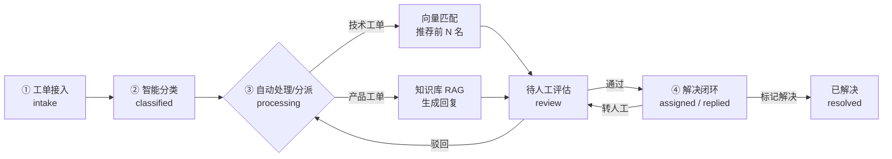

# Support Agent · 智能工单系统

基于 **Flask + 轻量向量库 + deepagents 混合编排** 的企业 IT 智能工单系统。覆盖工单接入、智能分类、Agent 知识库自动回复、技术工单按擅长领域自动分派、人工评估把关、解决闭环的完整闭环。

前端 1:1 还原 Microsoft Support Agent 风格的看板界面，后端为大模型可插拔架构（默认 DeepSeek，可切换 OpenAI / 任意 OpenAI 兼容服务，未配置密钥时自动降级为内置规则）。

---

## 目录

- [核心能力](#核心能力)
- [工作流设计](#工作流设计)
- [技术栈](#技术栈)
- [快速开始](#快速开始)
- [配置说明](#配置说明)
- [目录结构](#目录结构)
- [API 一览](#api-一览)
- [爬虫与定时调度](#爬虫与定时调度)
- [测试](#测试)
- [注意事项](#注意事项)

---

## 核心能力

| 能力 | 说明 |
|---|---|
| **四节点工作流** | 工单接入 → 智能分类 → 自动处理/分派 → 解决闭环，全链路流程日志可追溯 |
| **大模型可配置** | 后台「系统设置」切换 provider / base_url / api_key / model，无需改代码 |
| **知识库自动回复** | 向量检索命中内部论坛知识库，LLM 生成分步骤回复，并展示命中来源与置信度 |
| **技术工单自动分派** | 技术人员擅长领域写入向量库，按问题语义匹配，推荐前 N 名候选人 |
| **人工评估把关** | 所有自动动作先进入「待人工评估」，人工通过才进下一环节；驳回则重新走流程 |
| **发送后仍可转人工** | 已回复/已分派工单支持一键「转人工」，打回人工评估环节 |
| **增量爬虫** | Playwright 爬虫骨架 + 模拟企业内部论坛数据，按 `kb_id` 增量去重入库 |
| **定时调度** | 内置 cron 调度器，后台可视化配置（预设频率 / 自定义 cron），每日自动增量爬取 |
| **降级可用** | 未配置大模型时，分类与回复自动降级为内置规则，开箱即可运行 |

## 工作流设计



**状态说明**

| 状态 | 含义 | 可执行操作 |
|---|---|---|
| `intake` | 工单已接入 | 自动流转 |
| `classified` | 已完成智能分类 | 自动流转 |
| `processing` | Agent 正在检索/匹配 | 立即处理 |
| `review` | 待人工评估 | 通过评估 / 驳回重走 |
| `assigned` | 已分派给技术人 | 标记解决闭环 / 转人工 |
| `replied` | 回复已发送 | 标记解决闭环 / 转人工 |
| `rejected` | 已驳回 | 自动重新走分类与处理 |
| `resolved` | 已解决闭环 | — |

## 技术栈

| 层 | 选型 |
|---|---|
| 后端 | Python 3.10+ / Flask 3 |
| 数据库 | SQLite（零部署，`row_factory = sqlite3.Row`） |
| 向量库 | 轻量自实现（numpy 余弦检索），支持本地哈希向量 / OpenAI Embedding |
| 大模型 | OpenAI 兼容协议（DeepSeek / OpenAI / Qwen / Ollama） |
| 工作流编排 | 内置状态机；安装 `deepagents` 后自动启用 Agent 编排，否则降级内置 RAG |
| 爬虫 | Playwright（骨架）+ 模拟论坛数据 |
| 前端 | Tailwind CSS CDN + 原生 JS 单页多视图 |

## 快速开始

### 方式一：一键脚本（Windows）

```bat
:: 启动：双击 start.bat，自动起服务并打开浏览器
start.bat
:: 退出：双击 stop.bat，按端口停止服务
stop.bat
```

### 方式二：命令行

```bash
cd support_agent
pip install -r requirements.txt
python app.py
# 打开 http://localhost:5000
```

首次启动会自动完成：建表 → 写入默认配置 → 灌入种子数据（6 名技术人员、16 篇知识文章、12 条示例工单）→ 重建向量库。

### 可选增强（不装也能跑）

```bash
pip install deepagents langchain-openai   # 启用 deepagents Agent 编排
pip install playwright                    # 启用真实网页爬虫
playwright install chromium
```

## 配置说明

所有配置存于 SQLite `settings` 表，后台「**系统设置**」页可视化修改。

| 配置项 | 默认值 | 说明 |
|---|---|---|
| `llm_provider` | `deepseek` | `mock` 内置规则 / `deepseek` / `openai`（任意兼容服务） |
| `llm_base_url` | `https://api.deepseek.com` | OpenAI 兼容 Base URL |
| `llm_api_key` | — | 模型密钥，前端密码框显示 |
| `llm_model` | `deepseek-flash` | 模型名 |
| `llm_temperature` | `0.3` | 采样温度 |
| `embedding_provider` | `local` | `local` 轻量哈希向量 / `openai` Embedding 接口 |
| `vector_dim` | `512` | 本地向量维度 |
| `auto_reply_confidence_threshold` | `0.7` | 自动回复置信度阈值 |
| `assign_top_k` | `3` | 技术工单推荐人数 |
| `crawl_enabled` | `true` | 是否启用定时增量爬取 |
| `crawl_schedule` | `0 2 * * *` | cron 表达式（分 时 日 月 周），默认每天 02:00 |
| `crawl_forum_url` | 空 | 正式环境企业内部论坛地址 |

> **切换到其他大模型**：把 provider 设为 `openai`，base_url 填目标服务的 OpenAI 兼容地址，model 填模型名即可，例如 Qwen `https://dashscope.aliyuncs.com/compatible-mode/v1`、本地 Ollama `http://localhost:11434/v1`。

## 目录结构

```
project10/
├── support_agent/                 # 后端服务
│   ├── app.py                     # Flask 入口与全部 API
│   ├── config.py                  # 路径与默认配置
│   ├── db.py                      # SQLite 建表与连接
│   ├── workflow.py                # 四节点状态机 + 人工评估
│   ├── llm.py                     # 可配置 LLM 客户端（含规则降级）
│   ├── knowledge.py               # 知识库 RAG 检索与置信度
│   ├── assignment.py              # 技术工单向量匹配与分派
│   ├── vector_store.py            # 轻量向量库（余弦检索）
│   ├── stores.py                  # 知识库/人员向量库装配
│   ├── deepagents_agent.py        # deepagents 可选编排
│   ├── scheduler.py               # cron 定时增量爬取调度器
│   ├── seed.py                    # 种子数据
│   ├── crawler/
│   │   ├── crawler.py             # Playwright 爬虫 + 增量入库
│   │   └── simulated_data.py      # 模拟企业内部论坛数据
│   ├── templates/index.html       # 单页应用骨架
│   ├── static/css/style.css       # 微软风格样式
│   ├── static/js/app.js           # 前端全部交互逻辑
│   ├── data/                      # 运行时生成（数据库/向量库）
│   ├── start.bat                  # 一键启动
│   └── stop.bat                   # 一键退出
└── support-agent-test-cases/      # 手动测试用例（HTML）
```

## API 一览

| 方法 | 路径 | 说明 |
|---|---|---|
| GET | `/api/dashboard` | 看板 KPI、流程计数、待分派、Agent 记录、最近工单 |
| GET | `/api/tickets` | 工单列表（支持 `status` / `ttype` / `search` / 分页） |
| POST | `/api/tickets` | 新建工单 |
| GET | `/api/tickets/<id>` | 工单详情 + 流程日志 |
| POST | `/api/tickets/<id>/process` | 执行分类与自动处理 |
| POST | `/api/tickets/<id>/approve` | 人工评估通过（正式分派 / 发送回复） |
| POST | `/api/tickets/<id>/reject` | 人工评估驳回，重新走流程 |
| POST | `/api/tickets/<id>/escalate` | 已回复/已分派 → 转人工评估 |
| POST | `/api/tickets/<id>/resolve` | 标记解决闭环 |
| PUT | `/api/tickets/<id>/reply` | 编辑 Agent 自动回复 |
| GET/POST/PUT/DELETE | `/api/technicians` | 技术人员管理 |
| GET/POST | `/api/knowledge` | 知识库文章列表 / 新增 |
| GET | `/api/knowledge/search` | 向量检索调试 |
| GET/PUT | `/api/settings` | 读取 / 批量更新配置 |
| POST | `/api/crawl/run` | 立即执行增量爬取 |
| GET | `/api/crawl/jobs` | 最近爬取任务 |
| GET | `/api/analytics` | 类型 / 状态 / 处理人分布 |

## 爬虫与定时调度

- **手动触发**：系统设置 → 爬虫与知识库入库 → 立即增量爬取。
- **定时触发**：勾选「启用定时增量爬取」，选择预设频率（每天 02:00 / 每天 08:00 / 每小时 / 每 30 分钟 / 每 5 分钟）或填自定义 cron。
- **调度实现**：`scheduler.py` 守护线程每 20 秒轮询配置，命中 cron 且该分钟未执行则触发 `run_crawl()`，同一分钟幂等。
- **增量策略**：以 `kb_id` 为唯一键，已存在则更新内容与 `updated_at`，不存在则新增。
- **接入真实论坛**：在 `crawler/crawler.py` 的 `crawl_with_playwright()` 中替换选择器，并在设置里填写论坛地址。

## 测试

完整的 36 条手动测试用例（含界面操作路径、预期结果、勾选列）见：

`support-agent-test-cases/support-agent-test-cases.html`

覆盖模块：环境启动 / 看板 / 工单管理 / Agent 自动回复 / 技术分派 / 团队管理 / 数据分析 / 系统设置 / 爬虫调度 / 端到端回归。

## 注意事项

- **首次启动会自动灌种子数据**；如需干净数据，删除 `data/support_agent.db` 与 `data/vectors.json` 后重新执行 `python seed.py`。
- **演示环境未做鉴权**，请勿直接暴露到公网。
- **不要把 API Key 提交到公开仓库**。生产部署建议改为读取环境变量，例如在 `config.py` 中：
  ```python
  "llm_api_key": os.environ.get("LLM_API_KEY", ""),
  ```
- 本地哈希向量仅用于离线可运行，语义精度有限；追求召回质量请切换 `embedding_provider=openai` 并配置 Embedding 模型。
- `deepagents`、`playwright` 为可选依赖，未安装时系统自动降级，不影响主流程。

---

**License**：MIT
